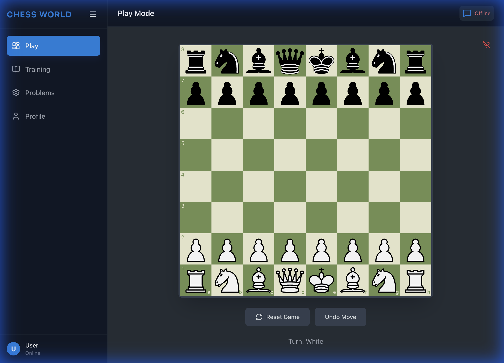
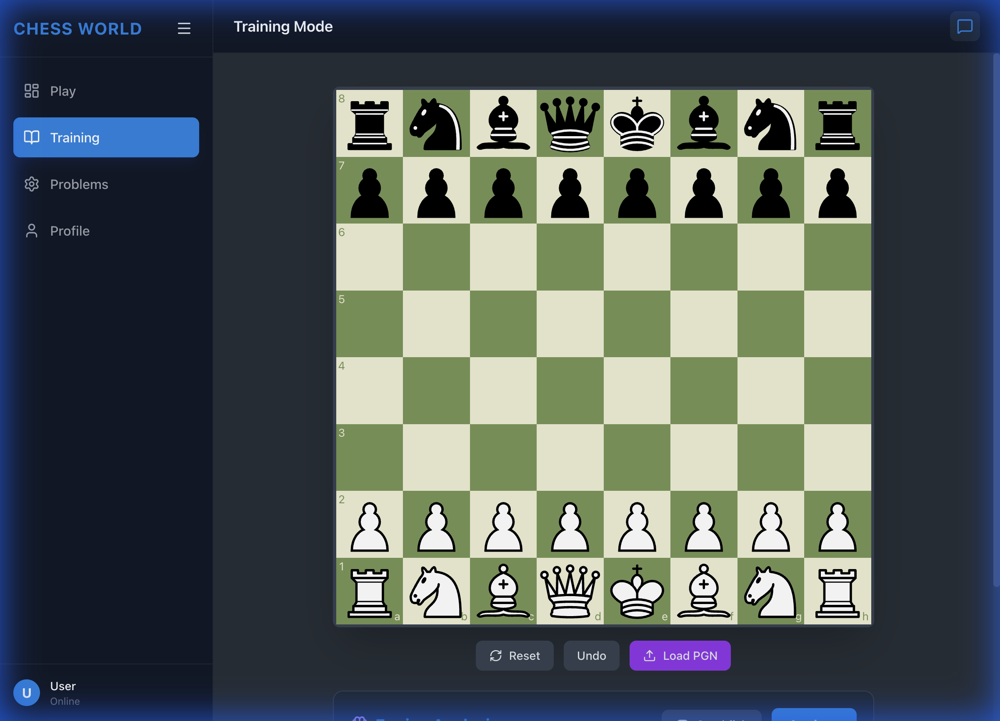

# Chess World ♟️

**Play, analyze, and improve at chess — powered by AI.**

Chess World is a full-featured chess platform where you can play multiplayer games, solve puzzles, analyze your games with a chess engine, and chat with an AI assistant — all in one place.



## ✨ Features

### 🎮 Play Mode
Interactive chessboard with drag-and-drop, legal move highlighting, and **real-time multiplayer**. Share a game URL to invite a friend — moves sync instantly via WebSocket.



### 📚 Training Mode
Upload your PGN files to replay and analyze games. Navigate move by move with engine evaluation (Stockfish or chess-api.com) and see the best moves, alternative lines, and win probability.

### 🧩 Problems Mode
Solve chess puzzles fetched from Lichess or a local database. Get visual hints, adaptive board orientation, and track your rating. New puzzle at every click.

### 🤖 AI Assistant
Chat with a local LLM (Ollama) that understands the board position. Send screenshots for visual analysis, ask for move suggestions, or get explanations of tactical themes.

### 🔐 Authentication
Secure signup/login with JWT. Your profile, ELO, and game history are persisted in the database. Protected features unlock after authentication.

### 📊 Profile
Track your ELO rating, win/loss statistics, and recent activity.

---

## 🏗️ Architecture

| Layer | Stack |
|---|---|
| **Frontend** | React 18 + Vite + Tailwind CSS |
| **Backend** | FastAPI (Python) |
| **Database** | PostgreSQL via Supabase (SQLite in dev) |
| **Real-time** | WebSocket (FastAPI) |
| **Chess Engine** | Stockfish + chess-api.com |
| **AI** | Ollama (local LLM) |

---

## 🚀 Deployments

| Component | Platform | Status |
|---|---|---|
| **Frontend** | GitHub Pages → [torbidos7.github.io/chess-world](https://torbidos7.github.io/chess-world/) | ✅ Live |
| **Backend** | Render.com → `chess-world-api.onrender.com` | 🔄 In setup |
| **Database** | Supabase (PostgreSQL) | 🔄 In setup |

See [DEPLOY.md](DEPLOY.md) for detailed deployment instructions.

---

## 🧑‍💻 Local Development

```bash
# Backend
cd backend
python3 -m venv venv
source venv/bin/activate
pip install -r requirements.txt
uvicorn backend.main:app --reload --port 8001

# Frontend
cd frontend
npm install
npm run dev
```

Open `http://localhost:5173` and start playing.

---

## 📄 License

MIT — © 2025 Daniele Buschi
